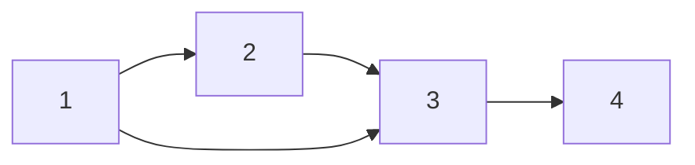

**Input:** Digraph $G=(V,E)$  and a source vertex $s \in V$
**Output:** Array `dist_s` where for every $t \in V$, `dist_s[t] = ` distance from $s$ to $t$.

BFS has a frontier list $F$ and seen list $S$. Initially, only the source vertex $S$ is in both $F$ and $S$. At each iteration of BFS, run until we hit a certain vertex or after $n-1$ iterations where $n$ is the number of vertices:
1. Update $F$ to contain the neighbors of the vertices currently in $F$
2. Add all the vertices in $F$ to $S$
3. Update something else (ie. distance list, "discovered" list) to find distances or paths.

**Example:**
Given the following digraph and source vertex $1$, find the shortest path from $1$ to $4$

| $t$ (How many iterations of BFS have we done) | $F$     | $S$         | $Prev$      |
| --------------------------------------------- | ------- | ----------- | ----------- |
| Initial, $t=0$                                | `{1}`   | `{1}`       | `{s,x,x,x}` |
| $t=1$                                         | `{2,3}` | `{1,2,3}`   | `{s,1,1,x}` |
| $t=2$                                         | `{3,4}` | `{1,2,3,4}` | `{s,1,1,3}` |
Shortest path from $1$ to $4$ according to $Prev$ is $[1,3,4]$

Frontier is the present
Seen is the present and past