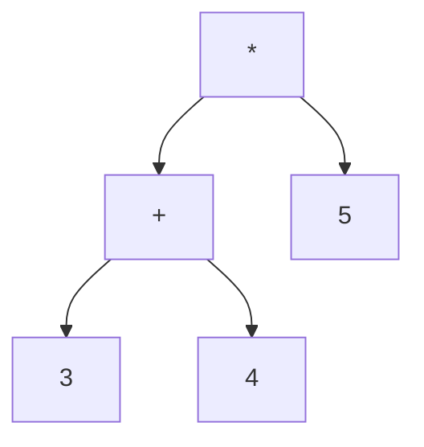

We use abstraction to apply the same patterns to seemingly dissimilar mechanisms in order to simplify problems.

### Syntaxical Quirks
Integer literals: `3` or `4` or `-100`
Integer Binary operators: `+`, `-`, `*`, `/` (operators that take two arguments)
Floating Binary *operators*: `+.`, `-.`, `*.`, `/.`
Unary operators: `~-` (tilde hyphen, integer negation)
Double semicolon `;;` markes the end of an expression

System reads the expression, evaluates it, prints the results, and then loops back to the start. (REPL)

The English phrase "iced tea drinker" is ambiguous because it can denote a drinker of cold beverages or a cold drinker of beverages.

We ensure that our programming language isn't ambiguous through conventions (ie. order of operations) and annotations (things that break conventions, ie. parantheses).

Abstract syntax tree:

Concrete syntax equivalent `(3 + 4) * 5`

Concrete syntax is just unstructured text whereas abstract syntax usually is a structured and diagrammatic.

Comments should describe the why rather than the how of a program.

OCaml is:
- **Strongly** typed (Types are stricly enforced, adding the integer 1 to the string "hello" will cause an error)
- **Statically** typed (Types for variables are determined during compile time, programs don't need to be run to determine types)
- **Implicitly** typed (Ocaml infers what type you want your variable)

### Floating point arithmetic
By typical binary operators (`+`, `-`, `*`, `/`) are for integers ONLY. That means ONLY integer inputs and integer outputs. To get floating point operators, add a dot. `5 / 2` evalutes to `2`. `5. /. 2.` evalues to `2.5`. Note that both arguments to a floating point operation must be floats.

### Booleans
OCaml has the `true` and `false` truth values.
Boolean operators:
- `||` OR
- `&&` AND
- `not` NOT

Comparison operators `<`, `>`, `<=`, `>=`

### If statements
`if [condition] then [expression if true] else [expression if false]
Atleast as of now, if statements return a value that can be used, not execute a piece of code

### Types
You can specify the type of a value using the `:`. For example:
- `42 : int`
- `true : bool`
- `(3.14 *. 2. * 2. : float)`

We use the unit value `()` to represent no value. It is the only value of the type `unit`.

### Functions are values
Functions can be passed as arguments and return by other functions. The functions that take other functions as arguments or return functions are called **higher order functions**.

The type of a function is `[input type] -> [output type]`. For example:
- `sqrt` has type `float -> float`

An expression that cannot be simplified any further is called a value.